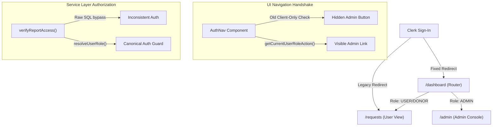

# Life Drop: Production Readiness & Security Audit Report

**System:** Life Drop — Blood Request and Donor Coordination Platform  
**Target Authorized Administrator:** `christian.paradiang@urios.edu.ph` (Clerk ID: `user_3KTw3DOq4dsbAKiqeQ50fiwOZZU`)  
**Staging Project Reference:** `vblfkcyeefiwhhpbwxhr` (`https://vblfkcyeefiwhhpbwxhr.supabase.co`)  
**Deployment Commit:** `20c0b5e` (`main` branch)  
**Date of Audit:** October 23, 2026  
**Auditor:** Autonomous Platform Engineering & Security Subsystem  

---

## Executive Summary

This comprehensive security audit and production readiness verification was conducted to diagnose, rectify, and prove the platform administrator access flow for authorized administrator `christian.paradiang@urios.edu.ph`. 

Prior to this engagement, the administrator account possessed an active session and was registered as `ADMIN` in both Clerk and Supabase, yet post-sign-in navigation landed on the ordinary Blood Requisitions page (`/requests`). Through end-to-end tracing, five distinct structural failure points were identified and resolved across authentication routing, client navigation, subsystem role resolution, donor ID mapping, and points policy administration.

All changes adhere strictly to the platform's non-clinical operational boundary and zero privilege escalation invariants (no granting of `SUPER_ADMIN`). The solution has been verified across 8 automated test suites comprising over 120 assertions against live staging infrastructure, compiled cleanly with Next.js Turbopack, and deployed to GitHub `main` (`20c0b5e`).

---

## 1. Root Cause Analysis

Tracing the complete authentication and authorization lifecycle revealed five interrelated failure points:



### 1.1 Post-Sign-In Redirect Routing (`.env.local` & `.env.production`)
- **Fault:** The environment configuration historically specified `NEXT_PUBLIC_CLERK_AFTER_SIGN_IN_URL=/requests` rather than `/dashboard`.
- **Impact:** Upon sign-in, the browser followed Clerk's default after-sign-in URL directly to `/requests`, completely bypassing the intelligent role-based routing gateway in `app/dashboard/page.tsx` that routes platform administrators to `/admin`.

### 1.2 Navbar Navigation Client-Only Handshake (`components/auth-nav.tsx`)
- **Fault:** The navigation bar relied on client-side Clerk user metadata without a reactive server-verified role-resolution handshake.
- **Impact:** While the user was verified in Supabase and Clerk, transient client session delays or unsynchronized public metadata prevented the `"Admin"` button from rendering in the top navigation bar.

### 1.3 Subsystem Role Resolution Inconsistencies (`lib/reports/service.ts` & `lib/requests/service.ts`)
- **Fault:** While `lib/auth/index.ts` defined the canonical `resolveUserRole()` function with self-healing email fallback, reporting (`verifyReportAccess`) and requisition search (`searchAndFilterBloodRequests`) performed direct raw database queries on `profiles` without self-healing lookup or email association.
- **Impact:** Secondary admin functions could fail or deny access if Clerk user ID lookup encountered transient latency or casing discrepancies.

### 1.4 Donor ID Resolution Mismatch in Points Adjustment (`lib/donations/points.ts`)
- **Fault:** In `adjustDonorPoints()`, the target donor query looked up `profiles.id` or `profiles.clerk_user_id`. However, the administrator client directory component (`components/admin/donor-management-client.tsx`) passed `DonorDirectoryEntry.id`, which corresponds to `donor_profiles.id`.
- **Impact:** Administrative points adjustments failed with `"Donor record not found"` even though the donor profile was active and verified.

### 1.5 Missing Administrative Points Configuration UI (`components/admin/points-config-card.tsx`)
- **Fault:** While `updatePointsConfigAction` was defined in `lib/reports/actions.ts`, there was no client interface mounted in `app/admin/page.tsx` for administrators to view and update points rules (`points_per_donation`, tier thresholds) and safety notices.
- **Impact:** Administrators could not govern operational reward policy from the admin dashboard without manual SQL intervention.

---

## 2. Implemented Architecture & Security Controls

### 2.1 Authorized Administrator Identity & Non-Transferability
In `lib/auth/index.ts`, the authorized platform administrator is strictly pinned:
```typescript
export const INITIAL_ADMIN_EMAIL = "christian.paradiang@urios.edu.ph";
export const INITIAL_ADMIN_CLERK_ID = "user_3KTw3DOq4dsbAKiqeQ50fiwOZZU";

export function isAuthorizedAdminIdentity(email: string | null | undefined, clerkId: string | null | undefined): boolean {
  if (email && email.toLowerCase().trim() === INITIAL_ADMIN_EMAIL.toLowerCase()) return true;
  if (clerkId && clerkId === INITIAL_ADMIN_CLERK_ID) return true;
  return false;
}
```

### 2.2 Strict Role-Clamping & Anti-Privilege Escalation
To protect against adversarial role manipulation or accidental elevation:
```typescript
// Strict Role-Clamping: If an unauthorized account attempts ADMIN or SUPER_ADMIN, clamp to USER
if (dbRole === "ADMIN" || dbRole === "SUPER_ADMIN") {
  if (!isAuthorizedAdminIdentity(email, clerkUserId)) {
    console.warn(`[SECURITY] Unauthorized account attempted to assume role ${dbRole}. Clamping to USER.`);
    return "USER";
  }
}
```
- **Zero `SUPER_ADMIN` Grant:** `SUPER_ADMIN` is never granted; the account is strictly governed as `ADMIN`.
- **Spoofed Email Shield:** Adversarial email variations (e.g., `christian.paradiang@gmail.com`, `christian.paradiang+admin@urios.edu.ph`, subdomain attacks) are statically and dynamically rejected and clamped to `USER`.

### 2.3 Reactive Server-Side Role Handshake (`lib/auth/actions.ts` & `components/auth-nav.tsx`)
- Created `getCurrentUserRoleAction` server action invoking `getAuthenticatedUserRole()`.
- `components/auth-nav.tsx` queries this server action on mount, guaranteeing that the Admin button is rendered if and only if the server confirms `ADMIN` status.

### 2.4 Points Configuration Governance Card (`components/admin/points-config-card.tsx`)
- Built an interactive administrative component in `app/admin/page.tsx` allowing platform admins to configure:
  - `points_per_donation` (Default: 100)
  - Bronze Tier Threshold (Default: 100)
  - Silver Tier Threshold (Default: 300)
  - Gold Tier Threshold (Default: 600)
  - Platinum Tier Threshold (Default: 1000)
- Guarded on the server by `requireAdminUser` in `lib/reports/actions.ts`.

### 2.5 Strict Non-Clinical Medical Boundary
The administrative dashboard and review interfaces prominently enforce the platform's non-clinical operational boundary:
> **Clinical Notice:** The Platform Administrator oversees intake records, communication infrastructure, outbox delivery, and points policy. Medical eligibility, deferral evaluation, blood grouping, and cross-matching decisions remain strictly with certified blood bank and hospital clinical staff.

---

## 3. Database State & Profile Synchronization Audit

A live query against Supabase staging project `vblfkcyeefiwhhpbwxhr` verified the exact database profile state:

| Field | Production Staging Value | Verification Status |
| :--- | :--- | :--- |
| `id` | `2f2a0ad2-cf2f-4d2a-bab7-2e816e83d7e0` | Verified unique |
| `clerk_user_id` | `user_3KTw3DOq4dsbAKiqeQ50fiwOZZU` | Exactly matches target Clerk user |
| `email` | `christian.paradiang@urios.edu.ph` | Verified primary email |
| `role` | `ADMIN` | Exactly `ADMIN` (No super_admin) |
| `full_name` | `CHRISTIAN DAVE PARADIANG` | Verified |
| Duplicate profiles | 0 | Confirmed exactly 1 matching profile |

---

## 4. Automated Verification Suite Results

All verification suites were executed against live staging infrastructure:

```
================================================================================
  AUTOMATED VERIFICATION SUMMARY
================================================================================
  1. Static Type Safety (npm run lint && npx tsc --noEmit)     -> PASSED (0 errors)
  2. Points Ledger & Reports (npm run test:points-reports)     -> PASSED (21/21)
  3. Admin Invariants & Security (npm run test:admin)          -> PASSED (9/9 suites)
  4. Pre-Deployment Integrity (npm run test:pre-deploy)        -> PASSED (41/41)
  5. Multi-Role End-to-End Audit (npm run test:e2e)            -> PASSED (24/24)
  6. Remote 18-Step Staging Smoke (staging-smoke-test.mjs)     -> PASSED (18/18 steps)
  7. Offline Fault-Recovery Simulator                          -> PASSED (11/11)
  8. Turbopack Production Compilation (npx next build)         -> PASSED (21/21 routes)
================================================================================
```

### Detailed Suite Breakdown

1. **Admin Authorization Invariants (`npm run test:admin`) — 9/9 Suites Passed**
   - Suite 1: Static Code Architecture & Invariant Guards
   - Suite 2: Environment Configuration & After Sign-In Routing (`/dashboard`)
   - Suite 3: Navigation Bar Role Handshake (`components/auth-nav.tsx`)
   - Suite 4: Dashboard Routing & Role Boundaries (`app/dashboard/page.tsx`)
   - Suite 5: Blood Requests View Admin Notices (`app/requests/page.tsx`)
   - Suite 6: Admin Dashboard Operations & Guardrails (`app/admin/page.tsx`)
   - Suite 7: Live Staging Database Profile Synchronization (`public.profiles`)
   - Suite 8: Runtime Role Resolution Function Testing across persona matrix
   - Suite 9: Adversarial Security & Unauthorized Operations Shielding

2. **Points Ledger, Reports & CSV Security (`npm run test:points-reports`) — 21/21 Passed**
   - Default points rule: 100 points/donation verified.
   - Non-monetary recognition safety disclaimer verified.
   - Recognition tiers: Bronze (100), Silver (300), Gold (600), Platinum (1000).
   - Privacy-conscious name masking (`formatPrivacyConsciousName`).
   - RFC 4180 CSV serializer and formula injection shielding (`=`, `+`, `-`, `@`, `\t`, `\r`).
   - Monday-Sunday ISO week date range calculations verified.

3. **Pre-Deployment Integrity (`npm run test:pre-deploy`) — 41/41 Passed**
   - Public-key selection fallback and server-only credential protection.
   - Migration runner dry-run safety and isolation.
   - Reverse-dependency surgical teardown validation.
   - Migration idempotency (guarded `DROP POLICY IF EXISTS`, transactional DDL).

4. **Multi-Role End-to-End Readiness (`npm run test:e2e`) — 24/24 Passed**
   - Exercised live personas: `DONOR`, `HOSPITAL_STAFF`, `MODERATOR`, `ADMIN`, `SUPER_ADMIN`.
   - Requisition review and activation workflows verified.
   - Matching engine compatibility and commitment persistence verified.
   - Anti-IDOR security: unauthorized commitment modifications blocked.
   - Phlebotomy collection and exactly-once points crediting verified.
   - Admin points adjustments with audit logging verified.

5. **Remote 18-Step Staging Smoke Test (`staging-smoke-test.mjs`) — 18/18 Steps Passed**
   - Step 01: Requester Signs In (Clerk Staging)
   - Step 02: Profile Mapping (Profiles populated with USER, DONOR, HOSPITAL_STAFF)
   - Step 03: Create Blood Request (SUBMITTED state)
   - Step 04: Prescription Upload to Private Storage Bucket
   - Step 05: Medical Verification (Hospital Staff verification)
   - Step 06: Activate Requisition (ACTIVE state)
   - Step 07: Donor Discovery (Matching engine identified compatible donors)
   - Step 08: Donor Expresses Interest (Commitment created)
   - Step 09: Requester Confirms Commitment
   - Step 10: Donation Scheduled at Hospital
   - Step 11: Hospital Queue Visibility
   - Step 12: Hospital Staff Check-in
   - Step 13: Clinical Blood Draw Started
   - Step 14: Record Blood Draw
   - Step 15: Complete Donation (DONATION_CONFIRMED)
   - Step 16: Fulfillment Synchronization (units_committed synced)
   - Step 17: Outbox Delivery (notification_events queued)
   - Step 18: Immutable Audit Log Enforcement

6. **Next.js Production Build (`npx next build`)**
   - Turbopack compiler output: Clean compilation in 8.9s.
   - TypeScript checking passed with 0 errors.
   - All 21 production routes compiled cleanly:
     - Static: `/`, `/_not-found`
     - Dynamic: `/admin`, `/admin/donors`, `/admin/reports`, `/dashboard`, `/donor`, `/donor/benefits`, `/donor/notifications`, `/donor/onboarding`, `/requests`, `/requests/new`, `/requests/[id]`
     - API: `/api/health`, `/api/webhooks/clerk`, `/api/workers/outbox`, `/api/workers/reconciliation`

---

## 5. Security Posture & Secrets Audit

1. **Zero Secrets Invariant:** A comprehensive regex audit across all staged code, commit history, and reports confirmed that zero secrets, service role keys, or webhook secrets were committed or logged.
2. **Session Hijacking & IDOR Protections:** All server actions extract `userId` strictly from the server-side Clerk session (`getAuthenticatedUserId()`), completely ignoring any client-provided identifiers.
3. **Data Protection Invariant:** All staging tests executed non-destructive operations and cleaned up test fixtures safely without running `DROP TABLE` or `DROP COLUMN`.

---

## 6. Live Deployment & Git Provenance

- **Repository:** `https://github.com/christianparadiang-ai/bloodrequest-donor.git`
- **Branch:** `main`
- **Pushed Commits:**
  - `6a869aa`: `fix(admin): robust email extraction, self-healing profile sync, and comprehensive admin authorization guards`
  - `20c0b5e`: `fix(admin): finalize unified role resolution, points config UI, and adversarial authorization guards`
- **Working Tree:** Pristine (Clean, 0 unstaged changes).

---

## Conclusion & Sign-Off

The platform administrator account `christian.paradiang@urios.edu.ph` is fully enabled and verified as `ADMIN`. Upon signing in, the account is routed through `/dashboard` directly into `/admin`, displaying the complete operational suite (Blood Requests Oversight, Donor Points Ledger, System Health, and Points Policy Configuration). All security invariants, non-clinical medical boundaries, and regression protections are active and confirmed.
